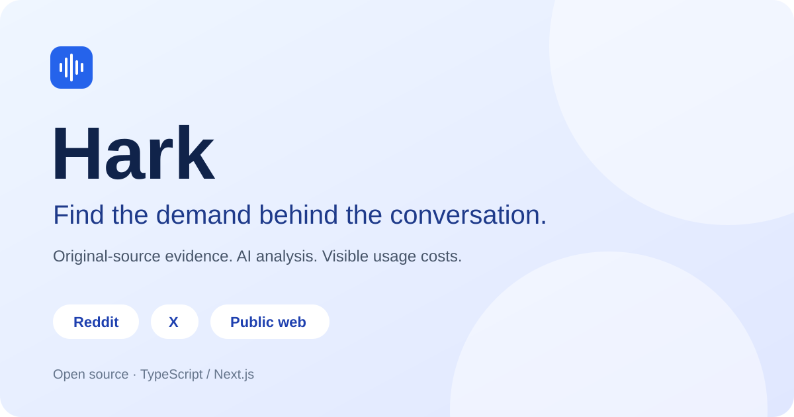

# Hark

**从公开讨论中发现需求，为产品寻找值得了解的人和问题。**



[](https://github.com/as992949791/Hark/actions/workflows/check.yml)
[](LICENSE)

[公网测试站](https://hark-as992949791.netlify.app) · [功能与验证记录](docs/DEVELOPMENT.md) · [本地配置](docs/LOCAL_SETUP.md) · [报告问题](https://github.com/as992949791/Hark/issues)

Hark 是一个使用 TypeScript / Next.js 构建的 AI 需求研究工作台。你可以输入产品网址寻找潜在用户，也可以输入需求主题研究尚未解决的问题。系统从 Reddit、X 和网页搜索发现公开内容，读取可访问的原文，生成需求候选和痛点主题，并保留来源、引用与费用供人检查。

它也提供围绕产品的持续线索工作流：产品画像、来源配置、AI 筛选、线索处理、竞品提及、Reddit SEO、通知和只读 API。搜索、模型分析和人工判断各自承担不同的工作；AI 分数用于排序注意力，不能解释为购买概率。

> 当前为个人测试项目。公网测试站可能落后于仓库，自动付费任务保持关闭。首页设备预览中的样例不代表实时扫描结果。开源和免费托管额度不等于数据与模型调用免费。

## 适用场景

- **已有产品，寻找潜在用户**：发现正在求推荐、寻找替代工具或表达明确困难的人，查看产品是否真的能解决对方的问题。
- **尚未确定产品，调查需求**：围绕一个主题收集公开讨论，了解反复出现的困难、现有办法及其局限。
- **跟踪已有市场**：查看竞品提及、相关社区和 Google 已收录的 Reddit 讨论，再决定值得深入研究的方向。

## 功能

| 模块 | 能做什么 |
| --- | --- |
| 跨平台研究 | 手动输入产品网址或需求主题；组合 Reddit、X 与 Google 发现的公开网页来源 |
| 需求线索视图 | 按全文语境筛除教程、工具推荐和自推广；合并同一作者的重复需求，保留全部支撑引用 |
| 产品匹配校准 | 逐项核对能力、价格等明确要求；无依据保持未知，求本品替代者不能判为本品匹配 |
| 原文复用 | 手动选择已有研究的原文重新分析，保留原收集和到期时间，不重复购买同一批搜索资料 |
| 痛点主题视图 | 把相关线索整理为中文主题，回到支撑材料检查；区分来源数与已观察到的独立作者数 |
| 深入痛点分析 | 分开展示目前的解决办法和现有方案局限，每项附原文引用；未明确说明时不推断 |
| 每日持续监控 | 保存研究条件、邮件渠道与单轮／累计预算；默认暂停，首轮建立基线，之后提醒未记录的需求证据 |
| 产品画像 | 从产品页面提取方案、能力、目标用户和竞品；支持检查及编辑 |
| Reddit / X 线索 | 配置关键词与来源，AI 判断匹配度和意图；查看原帖、会话、理由和费用 |
| 线索处理 | 筛选、标记已回复、隐藏、不匹配与屏蔽，保留人工跟进的决定权 |
| 研究与配置 | 产品简报、竞品提及、Insights、Reddit SEO、来源与过滤设置 |
| 通知 | 邮件摘要和通用 Webhook；源码也包含 Slack / Discord 接入 |
| 用量与执行 | 展示请求费用、任务状态、部分失败和显式重试；研究任务先预留预算，再结算实际费用 |
| API / MCP | 通过用户拥有的只读密钥读取现有项目、Reddit 线索、SEO、主题和用量；不提供自动外联工具 |

跨平台研究默认面向海外英文公开来源，使用中文说明与总结，引用保留原语言。Google 用来找到原网页，不能替代原作者，也不能把搜索摘要当作已读取的完整文章。

## 一次研究怎样完成


- 产品模式复用当前拥有者的可用画像，或在本次任务内读取新产品页面；不会顺便创建监控项目或启动回填。
- 各阶段保留实际调用费用。无法确认扣费时保留预算并阻断重复购买，而不是把错误当成免费。
- 服务端检查引用是否确实出现在本次读取的原文中。无法访问的页面、无依据的事实和不明确的引用不能成为已验证证据。
- 某个来源失败时保留已成功结果，并明确展示部分失败；重试由用户显式发起并复用成功阶段。
- 项目、研究任务和读取接口按拥有者隔离。原文可以按保留规则到期，费用记录继续保留。

## 已验证到哪一步

2026-10-17 使用公开产品 **CapCut** 完成了一轮真实产品模式研究：

| 指标 | 实际结果 |
| --- | --- |
| 保存的来源文档 | 31 份 |
| 需求候选 | 13 条：Reddit 8、X 2、其他网页 3 |
| 痛点主题 | 5 个 |
| 原文校验 | 13 条引用均匹配保存的原文片段 |
| 运行状态 | 部分完成：两页无法抓取，其余提取和聚合完成 |
| 本次主任务费用账本 | $0.027140，按每次调用向上取整至微美元 |

这是一轮小样本执行记录，不是典型成本承诺，也不是获客效果证明。13 条是待判断的需求候选，不能称为 13 个有效客户；网页增量是否有用、主题是否有足够独立作者，仍需人工评估。该主任务费用不包含更早的连接探测、失败准备和其他任务，完整对账见[真实验收记录](docs/acceptance/23-capcut-live.md)。

随后对保存材料的[离线初筛](docs/acceptance/24-capcut-prescreen.md)发现：13 条候选来自 7 份原文，包含教程、推荐及自推广内容。3 个片段明确在求替代工具，但来自同一已记录账号的两篇帖子，不能计作 3 个独立潜客。原文引用准确已经验证，线索相关性和产品匹配仍需改进；这次助手初筛不代替用户的人工验收。

2026-10-18 已补充语境筛选、重复需求合并和逐项匹配校准。复用上述真实原文，主题模式最终将同一作者两篇帖子的 4 处表达合并为 1 个案例、1 个个别主题；新产品网址也成功完成一次真实页面读取与画像准备。已验证实际登录页面的输入、进度、重试、引用展开、主题跳转和刷新保留。中间错误和模型判断差异保留在[本轮验收记录](docs/acceptance/25-demand-quality.md)，这不等于另一轮全新搜索或一般质量保证。

其他验证包括真实 X 扫描、QQ 邮件收件、通用 Webhook、隔离的云端定时与任务恢复检查。以下项目仍未完成验收：

- 20 条结果中至少 16 条相关的人工质量目标。
- 更广泛的人工标注评估，以及两种模式的全新完整搜索。
- Slack / Discord 真实收件和钱包 OAuth；钱包工作暂缓。
- 新网页持续监控的真实付费／邮件验收，以及深入痛点分析的更广泛质量评估；已完成一次真实保存原文的分析，见[公网与真实分析验收](docs/acceptance/28-monitoring-public-live.md)。自动外联和商业效果未实现或验证。

持续监控与深入分析界面已发布至[公网测试站点](https://hark-as992949791.netlify.app/)，最新身份、迁移与真实分析记录见[验收报告](docs/acceptance/28-monitoring-public-live.md)。公网保留已有云端数据；本地研究结果未自动同步。付费检索、持续监控和自动通知继续关闭。

仓库完整 CI 在专用测试数据库上运行 TypeScript、ESLint、测试和生产构建。最新存档提交的结果请查看上方 Check 状态；本轮验证范围见监控验收记录。自动化测试通过不等于模型输出相关或已有用户采用。

## 技术栈与工程设计

| 层 | 技术 / 设计 |
| --- | --- |
| 前端 | Next.js 16、React 19、TypeScript、Tailwind CSS 4、Base UI、Lucide |
| 认证 | Clerk、服务端拥有者校验 |
| 数据 | PostgreSQL 17、Drizzle ORM 与迁移 |
| 公共内容 | AnyAPI TypeScript SDK：Reddit、X、Google 搜索与网页读取 |
| AI | OpenRouter；产品分析模型与 Jev 线索判断可分别配置；研究传输支持已验证的官方 DeepSeek JSON 模式 |
| 异步任务 | PostgreSQL 持久化任务、租约与恢复、阶段复用、费用预留及实际结算 |
| 通知 | SMTP / Azure 邮件、通用 Webhook、Slack / Discord 适配 |
| 部署 | Netlify + Neon 的个人测试配置，也保留 Docker 自托管入口 |
| 验证 | Vitest、隔离数据库测试、TypeScript、ESLint、GitHub Actions |

源码结构：

```text
src/app/                 页面、Server Actions 与 API 路由
src/components/          首页、工作台和各功能组件
src/lib/demand/          研究契约、预算、传输、证据校验、流水线与报告
src/lib/                 产品画像、线索、竞品、SEO、通知及其他领域逻辑
src/jobs/                持久化任务与调度
src/db/                  数据表、迁移和数据库连接
netlify/functions/       可选云端后台任务入口
tests/                   单元与数据库集成测试
docs/                    规格、开发记录、配置与验收边界
```

## 本地运行

需要 Node.js 24、npm、PostgreSQL，以及自己的 Clerk 应用。真实搜索另需 AnyAPI 和 OpenRouter 账号；不要把密钥放入聊天、Issue 或 Git。

```sh
git clone https://github.com/as992949791/Hark.git
cd Hark
npm ci
npm --prefix tools/local-postgres ci
cp .env.example .env
node -e "console.log(require('crypto').randomBytes(32).toString('base64'))"
```

将生成值填入 `APP_ENCRYPTION_KEY`，配置 Clerk 的两个密钥。可以连接自己的 PostgreSQL；使用仓库可选的本地数据库助手时，按[本地配置](docs/LOCAL_SETUP.md)设置 `127.0.0.1` 的连接地址。已有 `.env` 时不要覆盖它。

先以无付费调用的配置启动：

```dotenv
RUN_SCHEDULER=false
SCHEDULER_SEED=false
BACKGROUND_WORKER_ENABLED=false
SCHEDULED_WORKER_ENABLED=false
ALERT_INVITES=false
DEMAND_DISCOVERY_ENABLED=false
DEMAND_LIVE_ENABLED=false
DEMAND_MONITORING_ENABLED=false
HOUSE_DATA_CAP_USD_PER_DAY=0
HOUSE_LLM_CAP_USD_PER_DAY=0
HOUSE_X_DATA_CAP_USD_PER_DAY=0
HOUSE_X_LLM_CAP_USD_PER_DAY=0
```

```sh
npm run dev:local
# http://localhost:3000
```

支持的启动命令会检查连接、按需启动本地数据库助手并应用迁移。数据库助手使用持久目录 `.local/postgres`；其他平台的安装说明见[配置文档](docs/LOCAL_SETUP.md)。也可使用 `docker compose`，但启动前务必配置调度和费用上限，不能把镜像启动等同于零成本演示。

## 接入真实搜索

| 配置 | 用途 |
| --- | --- |
| `ANYAPI_HOUSE_API_KEY` | 实例用于公共内容请求的 AnyAPI 密钥 |
| `OPENROUTER_API_KEY` | OpenRouter 本身生成的访问密钥 |
| `OPENROUTER_MODEL` | 通用分析模型 |
| `OPENROUTER_PROFILE_MODEL` | 产品画像、简报及手动研究分析模型；空值回退到通用模型 |
| `JEV_MODEL` | 现有线索工作流的 Jev 判断模型 |
| `DEMAND_DISCOVERY_ENABLED` / `DEMAND_LIVE_ENABLED` | 手动研究界面和真实执行开关，两者均需明确开启 |
| `DEMAND_MONITORING_ENABLED` | 持续监控独立开关，默认关闭；还需定时／后台 worker、指定拥有者、现有邮件渠道、供应商密钥和正数费用上限 |
| `X_LEADS` | X 来源及已有 X 页面开关 |
| `HOUSE_*_CAP_USD_PER_DAY` | 实例每天的数据 / 模型费用上限和 X 子额度 |
| `SMTP_URL` / `ALERTS_FROM_EMAIL` | 可选邮件通知配置 |

研究页面位于 `/app/research`。先确认账号额度、模型访问权限和具体扫描预算，再开启对应开关与上限。DeepSeek 官方密钥不能直接填进 `OPENROUTER_API_KEY`；若使用 OpenRouter BYOK，应在 OpenRouter 账号内配置上游密钥。模型是否可用、是否支持格式参数以及实际费率，都取决于所选账号、模型和端点。

研究调用使用独立预算预留与 BYOK 费用结算；旧 SDK 调用路径仍有不同的费用控制语义，不能把手动研究的保障推及所有模块。详见[研究流水线](docs/acceptance/19-demand-pipeline.md)与[BYOK 记录](docs/acceptance/22-byok-readiness.md)。

## 开发与接口

```sh
npm run verify -- --quick          # TypeScript + ESLint
npm run verify                    # 加上完整测试和生产构建
npm run profile:replay -- tests/fixtures/profile-trace.json
```

日常先运行与改动有关的检查，最终以一次完整 CI 验证存档提交，避免重复执行无关流程。测试清除付费密钥并使用专用 `_test` 数据库。更多命令见[开发工具](docs/DEV_TOOLS.md)。

只读 API 使用工作台生成的 Bearer key，入口为 `/api/v1`；MCP 入口为 `/api/mcp`。接口范围见 [OpenAPI](public/openapi.json) 与 [Agent Guide](public/agent-guide.md)。现有只读接口不等于已开放手动研究任务的创建或结果 API。

## 当前计划

1. 人工检查真实候选，记录相关与不相关的原因，验证网页来源实际带来的增量。
2. 扩大已标注样本，检查混合测评/推荐帖等边界，按预算补充全新搜索。
3. 根据质量评估改进搜索与筛选，再考虑持续监控；钱包暂缓。
4. 功能和前端稳定后，再整理演示和项目展示材料。

## 许可证

[MIT](LICENSE)。源代码归属、版权与第三方来源说明保留在 [NOTICE](NOTICE) 中。Hark 独立维护，AnyAPI 是数据服务集成方。
